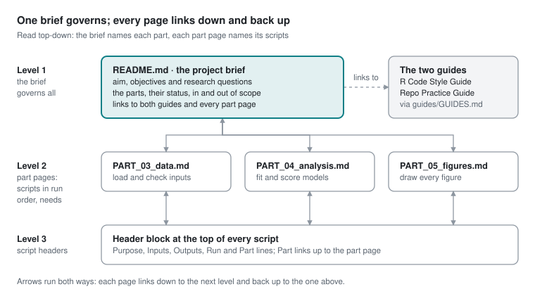

# Coding guides

Two guides for R analysis projects in infectious-disease epidemiology, kept in one place so that every project links here instead of carrying its own copy.

| Guide | Answers |
| --- | --- |
| [R Code Style Guide](R_CODE_STYLE_GUIDE.md) | How should a piece of code read? |
| [Repo Practice Guide](REPO_PRACTICE_GUIDE.md) | How is the project built and kept healthy? |

The R guide covers what happens inside a `.R` file or a Quarto chunk: layout, comments, names, grammar, functions, console output and plots. The repo guide covers everything around the code: the documentation hierarchy, folder layout, inputs and outputs, running, reproducibility, tests, git and upkeep.

## Using the guides in a project

**Link, never copy.** A project keeps one pointer page, `documentation/guides/GUIDES.md`, that links here at a tagged version and records when the project was last checked against it. A copy inside a project goes stale the day a guide changes.

**Start new projects from the templates.**

| Template | Becomes, in a project | Holds |
| --- | --- | --- |
| [project_README.md](templates/project_README.md) | `README.md` | the project brief: aim, research questions, scope, parts and Map |
| [PART_folder.md](templates/PART_folder.md) | `code/NN_part/PART_NN_part.md` | one part's scripts in run order, and what the part needs |
| [DATA_REGISTER.md](templates/DATA_REGISTER.md) | `data/DATA_REGISTER.md` | provenance, access, licence and personal data, per source |
| [GUIDES.md](templates/GUIDES.md) | `documentation/guides/GUIDES.md` | links to these guides, the version followed and the date last checked |
| [script_header.R](templates/script_header.R) | the top of every run script | Purpose, Inputs, Outputs, Run and Part lines |
| [function_file_header.R](templates/function_file_header.R) | the top of every function file | Purpose, Sourced by and Part lines |
| [gitignore](templates/gitignore) | `.gitignore` | session files, the renv library, regenerated outputs, private inputs |
| [Renviron.example](templates/Renviron.example) | `.Renviron.example` | every environment variable, its default and its meaning |

## Versions

Each release is a git tag (`v1.0`, `v1.1`, ...), and [CHANGELOG.md](CHANGELOG.md) says what changed and whether projects need to act. A new or changed Must rule, or a changed convention, raises the minor version; wording fixes wait for the next release. A project moves to a new version by checking itself against the changelog entries since its last check, then updating the version and date in its `GUIDES.md`.

## Changing the guides

The markdown files in this repository are the only maintained copy. Propose a change as an issue, or as a pull request that edits the guide directly, and say which rule changes and why. A change that alters a rule carries its CHANGELOG entry in the same pull request.

## Licence

The guides, templates and diagram are licensed under [CC BY 4.0](LICENSE): they may be shared and adapted, including commercially, with attribution. A suitable attribution: "Based on [coding-guides](https://github.com/reneniehus/coding-guides), CC BY 4.0."
