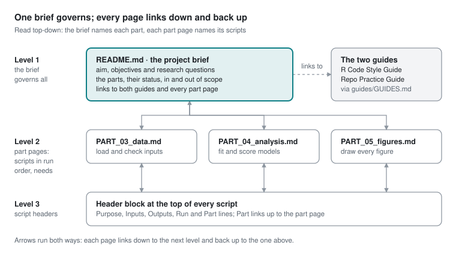

# Repo Practice Guide

*How is the project built and kept healthy?*

*Version 1.1, 19 November 2026. Maintained in [coding-guides](https://github.com/reneniehus/coding-guides); what changed between versions is in the [changelog](CHANGELOG.md).*

## Purpose and principles

A healthy project is one an authorised colleague can clone, read top-down from its brief, and rebuild every output with one command, without asking its author anything.

That colleague can also answer four questions from the repo alone:

| Question | Where the repo answers it |
| --- | --- |
| What is this project trying to establish? | The brief: aim, objectives or research questions, and each one's status |
| Which parts serve that aim? | The brief's parts and Map, then each part page |
| What inputs and assumptions produced this result? | Script headers, DATA_REGISTER.md, the settings version and the run manifest |
| Where do things go wrong if errors occur? | Assertions and console output, each part page's known issues, the tests |

Every rule in this guide follows from six principles:

1. **The brief governs.** The root `README.md` is the project brief: objectives, parts and status. Everything in the repo serves a part named there.
2. **Documentation is a hierarchy.** Brief, then part pages, then script headers. Each level links down to the next and back up.
3. **Inputs are read-only; outputs are disposable.** Raw data is never edited by hand, and every output can be deleted and rebuilt by a script.
4. **One command, one settings object.** A runner script rebuilds the project from its inputs, driven by a single versioned `params` list.
5. **Health is routine, not heroics.** Quick checks on every commit, a full rebuild before every report.
6. **The owner decides.** The repo prepares data, checks and structure; analysis plans, choices and recommendations belong to the project's owner, whoever builds the repo.

**Two strengths of rule.** *Must* is the default, broken only with a stated reason: a lasting departure goes in the Known departures table of documentation/guides/GUIDES.md, a one-off in a comment where it happens. *Prefer* is a default that judgement may overrule.

How code inside a file should read is the job of the [R Code Style Guide](R_CODE_STYLE_GUIDE.md).

## The documentation hierarchy

The root README.md is the project brief, and when any other page disagrees with it, the brief wins. Below it, documentation runs in three levels, and every page links down to the level below and back up to the one above.



The diagram shows the brief, README.md, linking across to the two guides and down to three example part pages. Each part page links down to the header blocks of its scripts. Every arrow runs both ways, because readers land anywhere and must be able to climb to the page that governs.

| Level | File | Answers | Links to |
| --- | --- | --- | --- |
| 1. Brief | `README.md` | What is the project for, where does each objective stand, what has it found, how is it run, what may be seen? | Both guides, every part page, `data/DATA_REGISTER.md`, every `documentation/` page |
| 2. Part page | `code/NN_part/PART_NN_part.md` | What does this part do, which scripts run in what order, what does it need? | Up to the brief; down to its scripts |
| 3. Script header | Top of each `.R` file | What does this script do, read and write, and how is it run? | Up to its part page (the `Part:` line) |

- **Must** correct any page that disagrees with the brief in the same commit that finds the disagreement. Example to avoid: a brief that describes five forecast hubs back to 2021 while a separate scope page still limits the work to two hubs and two seasons; the scope grew and only one page followed.
- **Must** keep the project's aim, its objectives or research questions with each one's output and status, and its in-scope and out-of-scope lists in the brief itself, never in a separate scope or overview page. A scope kept on a second page is the part nobody updates; when such a page exists, fold it into the brief and delete it (git keeps the old file).
- **Must** treat README.md as the canonical brief once the repo exists. An external copy, such as a one-page summary kept in a document store, is either regenerated from it or marked with the date it was last synchronised. Two editable briefs drift, and nobody can tell which one governs.
- **Must** give each piece of project information one home, at the level that owns it, so higher levels summarise and link instead of copying. Example to avoid: A brief's Layout block copied script lists and missed three scripts added later.
- **Must** keep one Map table in the brief (path | holds | link), with a row for every top folder, part page, data/DATA_REGISTER.md and documentation page. Root configuration files (.Rprofile, .lintr, .gitignore, .Renviron.example, \*.Rproj, renv/, renv.lock and any Python lock) share one grouped row. Example to avoid: a documentation page with no row, which nobody reading from the top can find.
- **Must** give every code part folder a part page named after the folder, such as code/03_data/PART_03_data.md, that lists its scripts in run order and states what the part needs: inputs with their access level, environment variables and fallbacks. What each script reads and writes lives only in its header, so the part page does not repeat it.
- **Prefer** a part page table of which output serves which objective or question of the brief, where readers need a catalogue, such as a part of figures. It names files but not what they read and write, which stays in the headers.
- **Must** name each documentation page by its role, so no two navigation pages share a name: README.md only at the root (the brief); PART\_\<folder>.md in each code part folder (code/03_data/PART_03_data.md); DATA_REGISTER.md in data/; GUIDES.md in documentation/guides/. Uppercase marks a navigation page; the lowercase pages in documentation/ are working pages. GitHub shows only README.md automatically in a folder view, so the brief's Map links every other page.
- **Must** open every script with a header block whose `Part:` line names its part page, or the brief for 00_main.R, 01_support/, 02_settings/ and the test helper and setup files. The [R Code Style Guide](R_CODE_STYLE_GUIDE.md) owns the header's format and its exemptions (test-\*.R files, files a tool generates); this guide owns where it links.
- **Must** open every page below the brief with an up-link, such as `Up: [project brief](../../README.md)`. Readers arrive through search and GitHub file views, not from the top.
- **Must** reach the guides through documentation/guides/GUIDES.md, never a copy. It links to their single home, a dedicated guides repository (github.com/reneniehus/coding-guides), at a tagged version, and records that version and the date the project was last checked against it. The guides keep being revised: a copy inside a project drifts, and nobody owns its refresh.
- **Must** let every number on a documentation page cite the committed script or output table that produces it, such as an agreement rate citing its row in a committed check table. A count with no committed source is backed by a committed check or left out. Example to avoid: counts made with scratch scripts that reached a data overview page and could not be rebuilt.
- **Must** keep documentation/ (never docs/) to the fixed pages below, each with one job; any other page needs a Map row or is folded in. Example to avoid: extra pages such as a strategy, pipeline or schedule page each give a piece of information one more place to go stale.

| Page | Holds | Entry shape |
| --- | --- | --- |
| `decisions.md` | Dated, append-only log of owner decisions and technical choices, each labelled as which | `## YYYY-MM-DD: <decision>`, the label, two lines of why, the commit or tag ("this commit" until the next tag fills it in) |
| `open_questions.md` | Decisions that wait for the owner, each with the facts it depends on; no options or recommendation unless asked | `## <question>`, its facts with links; deleted when a decisions.md entry closes it |
| `plan_<objective>.md` | One per objective: the analysis plan, written by the owner | The template's headings, empty until the owner writes them |
| `findings.md` | Lab notebook of dated discoveries: results, data quirks, failures and dead ends | `## YYYY-MM-DD: <finding>`, output file, settings version, current or superseded |
| `reflections.md` | Interpretation, caveats, overclaims to avoid, next analyses | Dated paragraphs |
| `data_overview.md` | The current reference for what the data contain and mean: codebook, verified fields, time conventions; links to findings instead of restating them | One section per source |
| `quickstart.md` | Clone to first result, with the Environment section (see Reproducibility) | Numbered steps |
| `guides/GUIDES.md` | Link to the guides repository at a tagged version; that version and the date last checked | Two lines |
| `guide_feedback.md` (optional) | Problems met with the guides, each with a proposed change | One table row per rule |

- **Must** record failures as fully as successes. Write a dated findings.md entry the moment a result appears; each negative result, dead end and abandoned approach gets one too, saying what was tried, what happened and why it was dropped. Otherwise the next person repeats the dead ends, and the results that survive look stronger than they are. The notebook is only useful if it records what failed as well as what worked.
- **Prefer** plain Markdown for every documentation page; a Quarto .qmd that computes numbers is a report, kept in a code part folder and rendered to output/ or artefact/. Example to avoid: a documentation page kept as .Rmd, which needs R before it can be read and whose links break in the GitHub view.
- **Must** write every new report or notebook as Quarto (`.qmd`), never a new `.Rmd`; convert an existing `.Rmd` when it is next reworked. One source renders HTML, Word and PDF. The Quarto CLI sits outside renv, so documentation/quickstart.md names the version the project uses.
- **Prefer** a CLAUDE.md, where one exists, of at most 20 lines: start at README.md, the guides, the commands and the never-do list, which includes "draft no plan, option or recommendation unless the owner asks". Any project information copied into it becomes a second governing page.

## Plans and decisions belong to the owner

The repo prepares data, checks and structure; the owner writes the analysis plans and takes the decisions. Whoever builds the repo, a collaborator or an AI assistant, lists what is open and leaves the choosing to the owner.

- **Must** give each objective a plan page, documentation/plan\_\<objective>.md, made from [templates/plan_objective.md](templates/plan_objective.md), with its headings and nothing under them until the owner writes it. Example to avoid: a first build that drafted two plan pages with a recommendation per decision, which pre-empted the owner and had to be removed.
- **Must** list each decision that waits for the owner on documentation/open_questions.md, with the facts it depends on, each fact linked to a committed table or page. It carries no options, ranking or recommendation unless the owner asks for them; an answer to such a request says so and is dated. Listing what must be decided is repo work; choosing is the owner's.
- **Must** keep choices the owner has not made out of code and pages: no planned-scripts table, no draft pipeline and no helper that fixes an open choice. Example to avoid: a page of facts and open questions, and an as-of input builder, that each embedded choices nobody had asked for.
- **Must** show a part that waits for its plan in the runner and on its part page: a Status line ("waiting for the owner's plan"), the data in place, and a placeholder entry function that reports this and writes nothing. Every part then appears in 00_main.R from the start, and nothing in it writes the plan in the owner's place.
- **Must** log in decisions.md only owner decisions and technical choices, each labelled as which. Drafts, options and items to confirm stay on open_questions.md, and the decisions.md entry that settles one removes it there. Example to avoid: build choices labelled as owner decisions, and drafted recommendations logged as entries.
- **Must** fix the protocol before the first result. Once the owner's plan is written, log its decisions in decisions.md and tag that commit `protocol-YYYY-MM-DD-<objective>`; any later change to it gets a dated entry saying it was made after results were seen. Choices of models, rounds, locations or truth vintage that are fixed after looking at scores are a forking path nobody can see.

```bash
git tag -a protocol-2026-12-01-objective1 -m "Objective 1 protocol, fixed before any result"
```

## Folder layout

Every repo uses the one tree below, so a colleague finds any file in any project without asking. The numbered code folders and the code/00_main.R runner are the same in every repo; part folders follow 02 in run order.

```text
<name>/
├── README.md               project brief; governs everything
├── CLAUDE.md               optional pointer for AI sessions, 20 lines at most
├── LICENSE                 code licence; required in a public repo
├── <name>.Rproj            opens RStudio at the root, where here() anchors
├── .Rprofile               sets the dated P3M repository, activates renv
├── renv.lock               R and package versions
├── renv/                   activate.R and settings.json committed; library/ gitignored
├── pyproject.toml, uv.lock only when a step runs Python: its version and hashed lock
├── .Renviron.example       every environment variable, its default and meaning
├── .lintr                  lint rules, from templates/lintr
├── .gitignore              written before the first commit
├── reproduce.sh            one command: inputs to every output and deliverable
├── fetch-<source>.sh       one per external source, if any: clones or downloads it
├── refresh-<output>.sh     one per recurring update, if any: pull, recompute, redraw
├── run_tests.R             runs the whole suite; exits non-zero on failure
├── code/
│   ├── 00_main.R           the runner: settings, then each part in run order
│   ├── 01_support/         setup.R (packages, conflicts, theme) and helpers; computes nothing
│   ├── 02_settings/        settings_vN.R, each returning one params list
│   ├── 03_data/            load and check inputs
│   │   └── PART_03_data.md part page: scripts in run order, what the part needs
│   ├── 04_analysis/        fit and score models
│   │   └── PART_04_analysis.md
│   ├── 05_figures/         one fig_<name>.R per figure, run script or function file
│   │   └── PART_05_figures.md
│   ├── 06_report/          builds the deliverables in artefact/
│   │   └── PART_06_report.md
│   └── 99_sandbox/         scratch scripts; never sourced, tested or linted
├── stan/                   Stan models, one per file; compiled models gitignored
├── data/                   inputs only, one folder per source, dated vintages with manifest.json
│   └── DATA_REGISTER.md    provenance, access, licence and personal data per source
├── output/                 everything code writes; regenerable
│   ├── tables/ figures/ fits/ cache/ logs/ reports/
│   ├── frozen/             committed results too costly to rebuild, one folder per protocol tag
│   ├── manifests/          one manifest per standalone entry point; gitignored
│   └── run_manifest.json   how the last full run was made; gitignored
├── artefact/               deliverables that leave the project, with manifests/<tag>.json
├── documentation/          decisions, open_questions, plan_<objective>, findings, reflections,
│                           data_overview, quickstart
│   └── guides/GUIDES.md    links to the guides repository at a tagged version; never a copy
└── tests/testthat/         unit and regression tests; fixtures/ holds small synthetic data
```

A few rules form a core that applies even to a one-off analysis; the rest of this guide is report-grade practice, adopted when a project first feeds a report. Part folders may be named by stage (03_data) or by evidence base (03_survey, 04_hubs), one convention per repo.

- **Must** apply the core to every project: the 00_main.R runner, a settings_vN.R returning params, a read-only data/, .gitignore before the first commit, no private data in a public repo, and a daily push. Without a stated minimum, a long guide gets ignored wholesale on small jobs.
- **Prefer** starting a new repo by copying the templates in the guides repository (coding-guides/templates/), which change together with the guides, rather than building the tree by hand. A template passes on conventions more reliably than rereading a guide.
- **Must** add nothing at the root without a row in the brief's Map; root configuration files share one grouped row. Ad hoc root folders, for example a db/ or figures/ that one script created, are where files get lost.
- **Must** keep 01_support/ to definitions, so sourcing it computes and writes nothing, and keep settings in 02_settings/. A settings file found anywhere else, such as a config.R among the helpers, moves to 02_settings/ as the next settings_vN.R.
- **Must** number part folders after 02 in run order, use each number once, and insert a part by renumbering. Example to avoid: two folders both numbered 05 (05_artefact/ and 05_figures/), so the number no longer gives the order.
- **Prefer** naming scripts verb_object.R, and giving each figure its own fig\_\<name>.R that writes output/figures/\<name>.\*. For example, load_erviss.R, fit_sir_model.R and fig_ili_slope.R read as a table of contents. When several figures share large tables, each fig\_\<name>.R may instead be a function file defining plot\_\<name>(), called by one draw\_\<part>() from 00_main.R, with one run\_\<part>.R for standalone redraws; otherwise every figure re-reads the same million-row tables.
- **Must** keep Stan models in stan/, one model per file, reached with here::here("stan", ...). Code that read './stan/SIR_simple.stan' broke whenever the working directory changed.

```r
# Avoid
sir_model <- rstan::stan_model("./stan/SIR_simple.stan")

# Prefer
sir_model <- rstan::stan_model(here::here("stan", "sir_simple.stan"))
```

- **Must** give each top folder one direction of flow: people write code/, stan/ and documentation/; code reads data/ and writes only output/ and artefact/, except a source's own fetch, freeze or de-identification script (see Sources and provenance). Example to avoid: a report script that writes its PDF into its own code folder, or an analysis script that writes derived tables into data/.
- **Must** name files and folders in lowercase ASCII, snake_case for R and data files, with no spaces and no final or new suffixes (README.md and the other uppercase navigation pages, LICENSE, test-\*.R and names a community format requires excepted); who delivered a file, and when, goes in data/DATA_REGISTER.md. Example to avoid: a folder named like data/'from a colleague end Nov test'/ breaks shell loops and says nothing about its contents.
- **Prefer** keeping scratch work in code/99_sandbox/, committed but never sourced by the runner, and pruned at each tag. Scratch work is code whose results feed no output or deliverable: exploratory plots, one-off data checks, trial model specifications, and test calls with hand-set arguments (such as # i = 1). Once its result is used, it moves into a part folder and gets a header. Working scripts then carry no if (FALSE) blocks, and the scratch survives a recycled container.
- **Prefer** defining project-wide reference definitions once: reference tables (country codes, EU/EEA membership, population) as a lookup in data/reference/ with a data/DATA_REGISTER.md row, and labels in code/01_support/reference.R, both read everywhere. Example to avoid: one script carrying its own EU/EEA country vector and label map while the settings hold a second copy of the labels.
- **Must** keep a method constant that more than one part needs in one home: a convention fixed by the source, such as a forecast hub's horizon anchoring, in code/01_support/reference.R, sourced by setup.R; anything that could change between runs in settings(). A reference fact a source gives only in prose, such as a few locations' different denominators, is transcribed once into a lookup in data/reference/ whose register row cites the prose. Example to avoid: a hub convention defined in one part's function file, so a later part had to receive it as an argument.

## Inputs: where data lives

data/ holds only what came from outside the project, each source in its own folder, every vintage kept and every file's origin written down.

### Sources and provenance

- **Must** never write to data/ from analysis code, and never edit a delivered file by hand. Three kinds of script write there, each into its own source folder: a fetch script; a de-identification script (such as make_public_survey.R); and a freeze or extract script that copies a dated, unmodified subset of an external clone into data/\<source>/\<vintage>/. Corrections are code with a comment saying why, logged in the vintage's manifest. Example to avoid: an analysis script that writes derived tables into data/. A hand-fixed spreadsheet cannot be told from the delivered one.
- **Must** keep each delivered extract, and each live download of a source that revises its own history, as a dated vintage folder such as data/erviss/2026-11-13/, never overwritten. For example, ERVISS backfills, so a re-download of the same week can return different numbers.
- **Must** have every script that writes a vintage also write its manifest.json, and have each loader verify the vintage against it on every load. The manifest holds each file's sha256 and row count, the source commits or download URLs, the rules applied, any correction, and the source files that were read but contributed no rows. Example to avoid: 14 header-only upstream files that left no trace in an extract, and recorded checksums that nothing checked.
- **Must** give every source a row in data/DATA_REGISTER.md: what it is, provider, vintages, refresh script, access level, licence and whether it holds personal data; for an extract of a repository, also the repository and commit of the code that generated the data. ECDC falls under Regulation (EU) 2018/1725, so personal data need their record, access list and deletion date named there.
- **Must** confirm in that row that the licence allows redistribution, with the attribution it requires, before committing a source or tables derived from it to a public repo. For example, committing ERVISS exports, a population table or forecast-hub-derived output/\*.csv to a public repo redistributes them.
- **Must** treat anything code cannot regenerate as an input, even if it was made in-house, with its own data/ folder and DATA_REGISTER.md row. For example, a hand-made synthesis saved in output/ would be destroyed by a clean; it belongs in data/\<source>/\<date>/.
- **Must** clone external repositories outside the project and locate each through one environment variable, read in settings(), with a default in a sibling folder, such as ../hubs/\<repo> for a forecast-hub clone. Example to avoid: the settings reading one variable while individual scripts read five others, each with a machine-specific default.
- **Prefer** reviewing a repository's hidden folders, such as .github/logs and its workflow definitions, before freezing an extract from it. Provenance can sit only there: one hub keeps the ensemble membership of each round in .github/logs/, and a first extract missed it.

When a source is missing, code stops with a message naming its fetch script. For example, a shell script that needs a forecast-hub clone checks for it first:

```bash
[ -d "$HUB_DIR/.git" ] || { echo "missing clone: $HUB_DIR (run ./fetch-hub.sh)"; exit 1; }
```

### Dates and vintages

- **Must** take every date that limits a run from params$as_of, set only in settings() from AS_OF. Without AS_OF, dev and refresh runs use today, or the newest committed vintage when every input is one, so an unchanged input gives an unchanged run; a full run stops. Example to avoid: a script that reads Sys.Date() deep inside, which nearly used a still-open forecast round's provisional ensemble (10 of 13 models).

```r
# ---- |-Data window and as-of ----
params$as_of <- read_as_of(params$mode)  # final-data cut-off; aborts in a full run without AS_OF
```

- **Must** have each loader read the newest vintage folder dated on or before params$as_of, never the latest folder on disk, through the one setup.R helper `newest_vintage()` (its code is in the [R Code Style Guide](R_CODE_STYLE_GUIDE.md)), and record its choice in the run manifest. Otherwise the folder read and the as-of date can disagree without anyone noticing.
- **Must** read the latest week of each series off the data, never from a date typed into a script. Example to avoid: figure scripts that typed `as.Date("2026-09-16")` instead of reading `max(ili_rates$week_end)`, so every weekly refresh needed a hand edit.
- **Must** check, when freezing an extract from a live clone, that it holds nothing newer than as_of. A full run aborts when the clone's commit is dated after as_of, or checks out the last commit before it, and the vintage manifest records the check. For example, a forecast hub rewrites a round's ensemble file several times around its deadline, so a round counts as final only when that file last changed after the deadline.
- **Must** record in data_overview.md each check that a field means what its name says, with its agreement rate and the row of the committed check table that produces it; the check itself is code, set by the [R Code Style Guide](R_CODE_STYLE_GUIDE.md). Any input field the analysis builds on gets this check once, so the next reader knows it was verified. Example to avoid, a forecast hub's 'median' row disagreed with its own 0.5 quantile in 60% of rows, because only a subset of models submitted values in the 'median' row.
- **Must** record each splice of two sources in decisions.md, with its tolerance, and keep the not-spliced table in output/tables/; the overlap check is code, set by the R Code Style Guide. Two countries differed by about 40% between an older extract and current data, which a splice would have turned into a trend.

### Private and restricted data

- **Must** state each repo's visibility and who has access in the brief's Status line. Private is the normal choice for work on restricted data or unpublished results; rules that name a public repo apply only once a repo is public. A private repo can still be made public, forked or opened to a new collaborator, so the history audit in Git hygiene runs before any of those.
- **Must** keep identifiable data only where everyone with access may see it: in a private repo whose access list matches the data's, or otherwise outside the working tree altogether, reached through a variable such as SURVEY_FULL_PATH. Git cannot stage a file that is not in the tree; .gitignore entries stay as a second line of defence.
- **Must** share data beyond the people cleared for it (a public repo, a published deliverable, a collaborator without access) only as a de-identified version made and verified by a script, named for its access level, and listed in the brief's Published / withheld table. For example, a public survey file with free text blanked (survey_public_notext.xlsx), whose closed answers the script that makes it verifies as unchanged.
- **Must** name every file by its real access level, such as survey_full_restricted.xlsx, and let the code run on either version and record which one in the manifest. Example to avoid: a file called \*\_deidentified.xlsx that still holds identifying free text, so its name says the opposite of its contents.
- **Must** give every derived file the access level of its most sensitive input, until a check shows otherwise: tables, figures, logs, caches and syntheses alike. For example, a theme synthesis of withheld free-text answers is as sensitive as the answers themselves.

## Outputs

output/ holds everything the code writes, and artefact/ holds what leaves the project; both are rebuilt by code and never edited by hand.

What a rebuild brings back depends on what the machine holds, so each mode states its needs. For example, a project with a dashboard, forecast-hub clones and a restricted survey might have three modes:

| Command | Needs | Rebuilds |
| --- | --- | --- |
| `./reproduce.sh page` | The committed files only | `artefact/dashboard.html`, byte-identical, from committed `output/artefact_data.json` |
| `AS_OF=2026-11-13 ./reproduce.sh` (full) | Hub clones from `./fetch-hub.sh` (several GB), the restricted survey through `SURVEY_FULL_PATH`, `AS_OF` | Every file in `output/` and `artefact/` |
| `./refresh-ili.sh` | Hub clones; `AS_OF` optional | The weekly ILI tables and figures |

In that example, a bare fresh clone runs only page mode and the tests, and a full run without the restricted survey falls back to the public copy, skips the free-text outputs and says so.

- **Must** keep in output/ only what code writes, so deleting it and rerunning a mode with that mode's inputs brings every file back. If output/ holds anything code cannot rebuild, nobody dares to clean it.
- **Must** state in quickstart.md what each reproduce.sh mode needs and rebuilds, including what a bare fresh clone can run. Example to avoid: a quickstart promising that 'rm -rf output/\* && ./reproduce.sh' rebuilds everything, which fails without the external clones or restricted inputs.
- **Prefer** organising output/ by kind (tables/, figures/, fits/, cache/, logs/, reports/), with the run manifest at its root. Example to avoid: dozens of files at one level, mixing CSV, JSON, DOCX, HTML and PDF.
- **Must** keep model fits and caches under output/fits/ and output/cache/, gitignored, and use a location outside the repo only through an environment variable. Example to avoid: Stan fits cached at '../Big data/fit\<country>.Rdata', a path with a space that no colleague has.
- **Must** commit a result that only a heavy environment can rebuild, such as forecasts from a pretrained model that needs Python, approved downloads and pinned weights, as one compressed frozen copy in output/frozen/\<protocol tag>/ with its manifest. It is rebuilt only under a new protocol tag, and quickstart.md says which reproduce.sh mode rebuilds it and what that mode needs. Such a result is neither a cheap regenerable output nor an input.
- **Must** build every deliverable in artefact/ with a script reachable from ./reproduce.sh, and render reports into artefact/ or output/reports/, never beside their source. Example to avoid: a decision note rendered into output/ among intermediate tables, so nothing showed what had been sent out.
- **Prefer** naming outputs for content and grain, with no version, date or person; only deliverables carry their as-of date, and only caches and logs their vintage or run date. Files a community format names, such as hubverse model-output/\<team>-\<model>/\<origin_date>-\<team>-\<model>.csv, follow that format. A stable name lets git show how a result changed. For example, output/tables/ili_rates_weekly.csv keeps its name from run to run, while the deliverable sent out is artefact/decision_note_2026-07-17.pdf.
- **Must** make every output traceable: its script's header Outputs line names it (for a write\_ or draw\_ function, its function file's header), figure captions name the building file, and the manifest records the run. A figure pasted into slides or an email can be traced to its code only if its caption names the script (caption rules are in the [R Code Style Guide](R_CODE_STYLE_GUIDE.md)).
- **Must** say in .gitignore, with a comment, which outputs are committed and why: the small tables a deliverable needs without heavy inputs, never caches, fits or logs. For example, committing output/\*.csv and a dashboard's data file with such a note lets the dashboard rebuild without the hub clones.
- **Must** change committed outputs only by regenerating them, in the same commit as the code, settings or data change that caused them, and review that diff as a change in results. A diff in output/ with no cause in its commit is a bug or an untracked input. Run manifests and logs record when a run happened, so they are exempt and are not committed on every run (see Reproducibility).
- **Must** tag the commit behind every deliverable that leaves the project, print the tag, settings version and as-of date in its footer, and commit the file as sent in artefact/, with a copy of its run manifest as artefact/manifests/\<tag>.json. A forwarded PDF then leads back to the exact code and data, even if pandoc later renders it differently.

```text
footer: Data as of 2026-11-13 | settings v2 | tag report-2026-11-17-decision-note
```

- **Prefer** keeping the console log of every full rebuild and refresh in output/logs/, for example with `./reproduce.sh 2>&1 | tee output/logs/$(date +%F)_reproduce.log`. Printed exclusions make a run auditable only while someone can still read them.

## Running the project

code/00_main.R is the one R entry point, ./reproduce.sh is the one command, and every setting a run depends on lives in one versioned params list.

```r
# +++++++++++++++++++++++++++++++++++++++++++++++++++++++++++++++++++++++++++++
### Run the analysis from inputs to deliverables ##################
# +++++++++++++++++++++++++++++++++++++++++++++++++++++++++++++++++++++++++++++
# Purpose: wire the parts together in run order; no analysis logic here
# Inputs:  data/ (one folder per source, see data/DATA_REGISTER.md); clones in .Renviron.example
# Outputs: output/, artefact/, output/run_manifest.json
# Run:     Rscript code/00_main.R, or section by section in RStudio
# Part:    README.md (the project brief)

gc()

# ---- |-Set up ----
source(here::here("code", "01_support", "setup.R"))
source(here::here("code", "02_settings", "settings_v2.R"))
params <- settings()

# ---- |-Data ----
source(here::here("code", "03_data", "load_erviss.R"))
ili_rates_by_country_week <- load_erviss(params)

# ---- |-Analysis ----
source(here::here("code", "04_analysis", "fit_sir_model.R"))
sir_fits <- fit_sir_model(params, ili_rates_by_country_week)

# ---- |-Figures ----
source(here::here("code", "05_figures", "draw_all_figures.R"))
draw_all_figures(params, ili_rates_by_country_week, sir_fits)

# ---- |-Report ----
source(here::here("code", "06_report", "build_report.R"))
build_report(params, sir_fits)

write_manifest(params, entry_point = "code/00_main.R")
cli_h1("Done")
```

- **Must** keep 00_main.R as the single R entry point for a full run: gc(), a Set up section that builds params, one function per part with params first, write_manifest(params, entry_point), then a closing `cli_h1("Done")`. One visible chain from params to data to fits is what lets a colleague follow a run.
- **Must** keep 00_main.R runnable section by section in RStudio, as well as end to end through Rscript. Stepping through the folded sections is how the runner gets debugged.
- **Prefer** keeping 00_main.R to wiring: loading, computing and writing happen inside part functions. Logic in the runner, such as an inline read of a cached file, is untested and missing from the part pages.
- **Must** let ./reproduce.sh reach every script that writes to output/ or artefact/; a script it cannot reach is a bug. Example to avoid: figure scripts run only by a separate refresh script, so a full rebuild silently skips them.
- **Must** keep all run settings in one settings() function in code/02_settings/settings_vN.R, returning one params list with a comment on every line. 00_main.R sources exactly one version; an unversioned settings file, such as a config.R, loses the record of which settings made a result.
- **Must** edit the current settings version in place until a tag or report uses it, then freeze it; the next change that alters results opens v(N+1). A new file for every modelling tweak would make the version number meaningless.
- **Must** make every switch a param (mode, as-of date, scope start, rapid fit, regenerate, fetch online, verbosity), and read environment variables only inside settings(). Example to avoid: a runner that types switches into calls (`load_data(params, regenerate = F)`), or a script that sets its own as-of and start dates.

```r
# ---- |-env_or_default ----
# Value of an environment variable; unset and set-but-empty both give the default
env_or_default <- function(name, default) {
  value <- Sys.getenv(name)
  if (nzchar(value)) value else default
}

# ---- |-settings ----
settings <- function() {
  params <- list()

  # ---- |-Run ----
  params$settings_version <- "v2"  # frozen once a tag uses it
  params$mode <- env_or_default("RUN_MODE", "dev")  # dev, refresh or full (report)
  params$rapid_stan_fit <- FALSE  # TRUE: vb meanfield, faster, never for reports
  params$regenerate <- FALSE  # TRUE: ignore caches and rebuild them
  params$simulation_seed <- 20261113L  # the one seed for every stochastic call

  # ---- |-Paths ----
  params$clone_dirs <- c(
    hub = env_or_default(
      "HUB_DIR",
      here::here("..", "hubs", "<hub-repo>")
    )  # forecast-hub clone made by fetch-hub.sh; one entry per clone
  )
  params$model_dir <- env_or_default("MODEL_DIR", here::here("..", "models"))  # weights, outside

  return(params)
}
```

- **Must** give every environment variable a project-relative default or a stated fallback, and a line in a committed .Renviron.example (name, default, meaning, scripts that read it); never commit .Renviron. Example to avoid: defaults such as /home/\<someone>/hubs or C:/Users/\<someone>/data, which exist on one machine only.
- **Must** treat an empty value as unset everywhere, and let a shell entry point read only variables that settings() also reads, with the same defaults; the repo-health test compares the names. A copied .Renviron.example leaves variables set but empty, and `Sys.getenv(x, unset = d)` then returns "", not d. Example to avoid: a fetch script whose default clone folder drifted from the one in settings().
- **Must** run each script in a fresh session with plain Rscript, never Rscript --vanilla, and make each standalone script source setup.R and the settings itself and write its own manifest. --vanilla skips .Rprofile, so renv never activates and the run silently uses unlocked packages.
- **Must** give each recurring update one refresh command at the root that pulls, recomputes and redraws with no code edits, and ends by listing what it refreshed. For example, a weekly refresh runs unedited once it reads every vintage and latest week off the data, never from a typed date.
- **Must** open each shell entry point with a header (what it does, usage and modes, when to run), then set -euo pipefail, `cd "$(dirname "$0")"`, prerequisite checks with a fix hint, and retried network steps, as in the example at the end of this section.
- **Prefer** a cheap mode for frequent runs (rapid Stan fit, page-only rebuild), recorded in the manifest, with report builds that stop unless mode is "full" and rapid_stan_fit is FALSE. Without that stop, a variational quick fit can reach a deliverable.
- **Prefer** adopting {targets} once full rebuilds get skipped because Stan fits are slow, with tar_option_set(seed = params$simulation_seed) and the settings version as a dependency of every target. targets reruns only what it sees change, so both must be inputs it can see.

For example, a weekly refresh script that follows these rules:

```bash
#!/usr/bin/env bash
# refresh-ili.sh: pull the hub clone, recompute the weekly ILI table, redraw its figures
# Usage: ./refresh-ili.sh   or   AS_OF=<YYYY-MM-DD> ./refresh-ili.sh
# When:  weekly, after the hub publishes; then read the log and commit
set -euo pipefail
cd "$(dirname "$0")"

[ -d "${HUB_DIR:-}/.git" ] || { echo "missing clone: set HUB_DIR, run ./fetch-hub.sh"; exit 1; }

for attempt in 1 2 3; do
  git -C "$HUB_DIR" pull --ff-only && break
  [ "$attempt" -lt 3 ] || { echo "pull failed 3 times: check the network"; exit 1; }
  sleep 30
done

Rscript code/04_analysis/compute_ili_weekly.R   # output/tables/ili_rates_weekly.csv
Rscript code/05_figures/fig_ili_slope.R         # output/figures/ili_slope_*.png
echo "refreshed: ili_rates_weekly.csv and the ili_slope figures"
```

## Reproducibility

Any tagged result must be rebuildable on a new machine from its tag, its lock file and its manifest, with nothing taken from memory.

- **Must** use renv in every repo, with snapshot type "implicit": commit renv.lock, .Rprofile, renv/activate.R and renv/settings.json, gitignore renv/library/, and snapshot in the same commit as any package change. Without a lock, nobody can say which package versions made the numbers; type "explicit" needs a DESCRIPTION file that an analysis repo does not have.
- **Must** point renv at a dated P3M snapshot built for the machine's distribution, so renv::restore() installs the same binaries on any machine. An undated repository gives whatever is current on the day, and some networks, such as a cloud container behind a proxy, cannot reach CRAN at all. [templates/Rprofile](templates/Rprofile) reads the codename from the machine instead of typing one.

```r
# .Rprofile: dated P3M snapshot for this machine's distribution, then renv
local({
  p3m_date <- "2026-11-02"  # change only in a commit that also updates renv.lock
  os_release <- if (file.exists("/etc/os-release")) readLines("/etc/os-release") else character()
  codename_line <- grep("^VERSION_CODENAME=", os_release, value = TRUE)
  codename <- gsub("^VERSION_CODENAME=|\"", "", codename_line)  # e.g. noble, jammy
  p3m_path <- if (length(codename) == 1 && nzchar(codename)) {
    paste0("__linux__/", codename, "/")  # Linux binaries for this distribution
  } else {
    ""  # macOS and Windows: CRAN binaries come from the plain dated URL
  }
  options(repos = c(P3M = paste0("https://packagemanager.posit.co/cran/", p3m_path, p3m_date)))
})
source("renv/activate.R")
```

- **Must** make the first renv.lock from a library that the dated snapshot can restore: build the library with renv::restore() or renv::install() from that snapshot before the first renv::snapshot(), or choose a snapshot date on or after the day a preinstalled library was installed. A lock taken from a preinstalled library can record versions newer than the snapshot date, which renv::restore() then cannot find.
- **Must** have setup.R warn when renv is not active, and record `renv_active` in the manifest. A machine whose Renviron.site sets RENV_CONFIG_AUTOLOADER_ENABLED=FALSE makes `source("renv/activate.R")` do nothing without a message, so runs silently use the system library.

```r
# ---- |-Check that renv is active ----
if (!requireNamespace("renv", quietly = TRUE) || is.null(renv::project())) {
  library_path <- .libPaths()[1]  # cli would read "{.libPaths" as a style, so name it first
  cli::cli_warn(c(
    "renv is not active: packages come from {.file {library_path}}.",
    i = "RENV_CONFIG_AUTOLOADER_ENABLED=FALSE, set in some containers, stops activate.R."
  ))
}
```

- **Must** take the R version from renv.lock, name it in quickstart.md, and have setup warn when the running R differs in minor version. For example, a container that ships R 4.3 cannot cleanly restore a lock made on R 4.4, the usual fresh-machine failure.

```r
# ---- |-Check the R version against renv.lock ----
lock_path <- here::here("renv.lock")
if (file.exists(lock_path)) {
  lock_r_version <- package_version(jsonlite::read_json(lock_path)$R$Version)
  running_r_version <- getRversion()
  if (lock_r_version[1, 1:2] != running_r_version[1, 1:2]) {
    cli::cli_warn(
      "R {.val {running_r_version}} runs, but renv.lock was made on R {.val {lock_r_version}}."
    )
  }
} else {
  cli::cli_alert_info("No renv.lock: package versions are not locked.")
}
```

- **Must** provision each machine through one mechanism, such as a cloud environment's setup script, never also a second one such as a committed SessionStart hook. Two mechanisms drift apart, and a removed hook tends to come back.
- **Must** let setup and code tolerate a missing renv.lock, .Renviron, external clone or private file, falling back to defaults or the public copy and saying which fallback they used. Example to avoid: a container setup script that assumed renv.lock existed and failed on a repo without one.

```bash
if [ -f renv.lock ]; then
  Rscript -e 'renv::restore(prompt = FALSE)'
else
  echo "no renv.lock: installing the packages code/01_support/setup.R loads"
fi
```

- **Prefer** keeping heavy optional dependencies (rstan, arrow, EasyABC) in a separate renv profile, restored with `RENV_PROFILE=modelling`, rather than dropping them. Example to avoid: a lock slimmed to speed up containers, which left a Stan fit that needed the dropped packages unreproducible.
- **Must** draw every random number from the one `params$simulation_seed`, set in settings and passed at each point of use, as the [R Code Style Guide](R_CODE_STYLE_GUIDE.md) shows for Stan, local draws and parallel maps. Example to avoid: a seed of 12 typed again inside an rstan::vb call, so changing params$simulation_seed changed nothing.
- **Must** write a run manifest on every run through one helper, write_manifest(params, entry_point) in code/01_support/. 00_main.R writes output/run_manifest.json, and each standalone script writes output/manifests/\<script>.json, so a partial run never overwrites the record of the full run. A manifest filled in by hand is soon not filled in at all.

| Field | Example | Filled from |
| --- | --- | --- |
| `entry_point` | `"code/00_main.R"` | the `entry_point` argument |
| `settings_version`, `mode` | `"v2"`, `"full"` | `params` |
| `as_of` | `"2026-11-13"` | `params$as_of`, resolved once in `settings()` |
| `git_commit`, `git_dirty`, `tag` | `"a1b2c3d"`, `false`, `"report-2026-11-17-decision-note"` | `git rev-parse HEAD`, `git status --porcelain`, `git describe --tags --exact-match` |
| `inputs` | `data/erviss/2026-11-13/erviss_iliari.csv` and its sha256 | `newest_vintage()`; `digest::digest(file = path, algo = "sha256")` |
| `outputs` | `output/tables/ili_rates_weekly.csv` and its sha256 | the paths the run's write functions returned |
| `clone_shas` | `{"hub": "9f8e7d6"}` | `git -C "$HUB_DIR" rev-parse HEAD` |
| `survey_version` | `"public_notext"` | The loader's fallback choice; one field per input that has a restricted and a public version |
| `r_version`, `os`, `toolchain` | `"4.4.1"`, `"Ubuntu 22.04"`, `"g++ 11.4"` | `sessionInfo()`, `R CMD config CXX` |
| `stan_backend` | `"rstan 2.32.6"` | `packageVersion("rstan")` or `cmdstanr::cmdstan_version()` |
| `renv_active`, `renv_in_sync` | `true`, `true` | `!is.null(renv::project())`, `renv::status()$synchronized` |
| `non_r_steps` | `{"python": "3.12.7", "lock_sha256": "...", "torch": "2.5.1"}` | the step's own report; see Non-R steps and pretrained models |
| `models` | `{"chronos-bolt-small": {"revision": "<commit hash>", "training_cutoff": "<date>"}}` | `params`; the model's card |
| `started`, `finished` | ISO 8601 times | `Sys.time()` |

- **Must** keep run manifests out of everyday commits, because their times, commit and git_dirty fields change on every run. Gitignore output/run_manifest.json and output/manifests/, and commit the copy beside each deliverable (see Outputs); or commit output/run_manifest.json only in the commit a tag points at. Say which in .gitignore. Example to avoid: a committed manifest that gave every commit a diff with no cause, and marked the tree dirty after every run.

- **Must** build outputs that feed a report from a clean working tree, so the manifest shows git_dirty false. The tag points at the commit that adds the deliverable and its manifest copy, whose parent is the commit the manifest names. A run from uncommitted code cannot be rebuilt from git.
- **Must** rebuild any tagged run to the same results: byte-identical for deterministic outputs (manifests and logs excepted), and within the regression tolerances for Stan fits. MCMC results differ across compilers and BLAS even with a fixed seed.

```bash
git checkout report-2026-10-07
Rscript -e 'renv::restore(prompt = FALSE)'
git -C "$HUB_DIR" checkout 9f8e7d6   # clone SHA from that run's manifest
AS_OF=2026-10-07 ./reproduce.sh   # as_of from that run's manifest
```

- **Must** key every cache by source, vintage and settings version, such as output/cache/erviss_2026-11-13_v2.rds, and let params$regenerate force a rebuild. A cache keyed by name alone silently serves an older vintage.
- **Prefer** deterministic outputs: sorted rows, fixed column order, stable rounding and no timestamps inside data files. A rebuild with unchanged inputs is then byte-identical, and git diffs show only real changes.

quickstart.md carries an Environment section with these items:

- the R version, as recorded in renv.lock;
- the install route: `renv::restore()` from the dated P3M snapshot, and how to confirm that renv is active;
- the one provisioning mechanism and what it installs;
- the environment variables, pointing to .Renviron.example;
- the styler and lintr versions used for the formatting checks;
- for any non-R step: the interpreter version, its lock file and where model weights live;
- what runs with nothing set: page mode and run_tests.R.

### Non-R steps and pretrained models

A step outside R, such as a Python forecast from a pretrained model, meets the same standard as R code: a lock, a header, a manifest entry and a place in the one command.

- **Must** lock each non-R environment with a hashed lock file committed at the root, such as uv.lock from uv, or requirements.txt from `pip-compile --generate-hashes`, and name the interpreter version in quickstart.md. An unpinned `pip install` gives whatever is current on the day, as an undated CRAN repository does.
- **Must** open each non-R script with the same header lines (Purpose, Inputs, Outputs, Run, Part) in its language's comment syntax, list it on its part page, and let ./reproduce.sh reach it.
- **Prefer** passing data between R and non-R steps through files in output/ with a stated grain, named in both scripts' headers, rather than an in-memory bridge such as reticulate. A file interface lets each side be run, tested and checked alone.
- **Must** pin every pretrained model to an exact revision, such as a Hugging Face commit hash and never a branch name like main, set as a params entry. A model repository can change under the same name.
- **Must** keep model weights outside the repo, in one folder named by a variable read in settings() (such as MODEL_DIR), with a Not here row in DATA_REGISTER.md giving the model, revision, licence and the training cut-off its authors state. Weights are neither inputs to commit nor clones of a source, and they run to gigabytes.
- **Must** record in the run manifest, for each non-R step, the interpreter version, the lock file's sha256 and the versions of the key packages, and for each model its revision and stated training cut-off. A model trained on data that overlap the evaluation period leaks, and only the cut-off shows it.
- **Prefer** running offline once the weights are downloaded, for example with HF_HUB_OFFLINE=1, so a run cannot fetch a newer revision without saying so.

## Tests and checks

An analysis repo needs three layers of checks, each with its own job and moment, and none replaces another.

| Layer | Catches | Where | Runs |
| --- | --- | --- | --- |
| Assertions | New bad data | Inside each `load_*()` and after each filter and join | Every run, refreshes included |
| Unit tests | Broken logic | `tests/testthat/`, on small fixtures | `run_tests.R` before every push or merge to main; CI |
| Regression tests | Unexplained changes in key numbers | `tests/testthat/test-regression.R`, after a full rebuild | Before every report or tag, and after a new settings version |

- **Must** put each source's data contract inside its load\_\*() function as assertions: required columns by name, unique keys, allowed values and ranges. Example to avoid: a codebook that addressed columns by index while fread's column order varied between files; a contract by name fails at once.
- **Must** assert expected counts wherever data enter or change shape, so the run stops and prints the offending values. `params$n_expected_countries <- 30L` shows the pattern; how to write assertions is in the [R Code Style Guide](R_CODE_STYLE_GUIDE.md).
- **Must** keep unit tests offline and under a minute, using small fixtures or data simulated with a known truth, never the network, hub clones or private files. For example, an offline suite that runs in about 30 seconds gets run before every push; tests that need gigabytes of clones do not get run.
- **Must** build fixtures for private sources from synthetic rows with the real column structure, never from sampled real rows. Fixtures are committed and run in CI, so a fixture cut from a restricted survey publishes that survey.
- **Must** unit-test what is easy to get wrong and expensive to notice: ISO-week helpers across 53-week years, join keys, per 100 000 conversions, exclusion rules, and steps feeding headline numbers. Example to avoid: weeks computed as days/7, which printed '1 weeks behind' when the truth was 2 ISO weeks.

```r
test_that("weeks behind counts ISO weeks, not days / 7", {
  last_week_end <- as.Date("2026-11-08")  # Sunday ending 2026-W45
  report_date <- as.Date("2026-11-17")  # Tuesday in 2026-W47
  expect_equal(iso_weeks_behind(last_week_end, report_date), 2L)  # days / 7 gives 1
})
```

- **Must** pin a handful of headline numbers as regression references, with their settings version, as-of date and, for Stan fits, a stated tolerance. An intended change updates the reference in the same commit as its findings.md entry.

```r
test_that("headline numbers match settings v1, AS_OF 2026-06-30", {
  hub_headline <- readr::read_csv(here::here("output", "tables", "hub_headline.csv"))
  expect_equal(hub_headline$n_weeks_hosp_covered, 255)  # deterministic: exact
})
```

- **Must** keep run_tests.R at the root, running the suite in a fresh session and exiting non-zero on failure, and run it before every push or merge to main. An optional pre-push hook enforces it.
- **Must** have a test that every relative link in README.md, the part pages, data/DATA_REGISTER.md and documentation/\*.md resolves to an existing file; [templates/test-repo-health.R](templates/test-repo-health.R) has one. A Map row is not a working link. Example to avoid: four pages that linked to two documentation pages that did not exist, while the Map check passed.
- **Must** add, in the same commit as each bug fix, a test or assertion that would have caught the bug. Each lesson in these guides was a bug found once, and a test keeps it found.
- **Prefer** a smoke test that runs 00_main.R end to end on fixtures through code/02_settings/settings_test.R, once a repo feeds a recurring report. Most pipeline breaks sit in the wiring between parts, which single-function tests miss.
- **Prefer** CI where hosted runners are allowed for the repo: setup-r with the R version from renv.lock, setup-renv for the cached library, no secrets or .Renviron, then the tests. CI then doubles as the standing fresh-clone check.

```yaml
- uses: r-lib/actions/setup-r@v2
  with:
    r-version: "renv"   # read from renv.lock
- uses: r-lib/actions/setup-renv@v2
- run: Rscript run_tests.R   # whole suite: offline, no clones or secrets
```

## Git hygiene

Git is both the project's memory and its likeliest leak: commit in small, explained steps, push daily, and keep private data out of every public history.

- **Must** write .gitignore before the first commit and before any data enters the folder, listing every private file by exact path with a comment saying why. Ignoring a file after it was committed does not remove it from history.

```text
# ---- private survey microdata: NEVER commit to a public repo ----
# full export; free text names countries and institutes
data/survey/survey_full_restricted.xlsx
# redaction input: the names make_public_survey.R removes
data/survey/redaction_names.csv
```

- **Must** never commit secrets: keep them in .Renviron or the environment's secret store, and list only their names in .Renviron.example. A secret in history must be rotated, because removing the commit does not un-publish it.
- **Must** commit a LICENSE for the code in every public repo, and state the data licence separately in the brief. Without a LICENSE nobody may legally reuse the code, and code and data rarely share one licence.
- **Must** write commit messages that say what changed and why: an imperative subject of about 72 characters at most, plus a body naming numbers and settings version when results change. A commit called 'edit' that adds a data file is invisible to anyone scanning history.

```text
Avoid:  edit
Prefer: Use the 0.5 quantile as ensemble median; median row differs in 60%
```

- **Must** make one logical change per commit, with its code, header, part page row, settings version and regenerated committed outputs together. A mixed commit cannot be reverted cleanly, and a split one leaves states where documentation contradicts code.
- **Prefer** short-lived branches named for the change, merged through pull requests and deleted after merging, AI-session branches included. Example to avoid: a finished AI-session branch left beside main.
- **Must** push commits and tags at the end of every session, and at least daily. Cloud containers get recycled and laptops fail; only what was pushed survives.
- **Must** keep files over about 50 MB and external bulk data out of git, commit binary inputs (xlsx, fst) only when small and needed, and use git LFS only by a recorded decision. Forecast-hub clones, for example, run to several gigabytes, and every committed version stays in history for good.
- **Prefer** a pre-commit hook that refuses files over 50 MB, paths on the private list, and data files outside data/. Only an automatic check stops a stray data file before it is committed.
- **Must** audit the full history, contents as well as paths, before a repo goes public, gains a remote, or shares commits with another repo; audit both repos in the last case. Repos that share commits share history: a file committed in either is in both pasts.

```bash
# paths, on every branch and tag (must print nothing)
git log --all --oneline -- data/survey/survey_full_restricted.xlsx data/survey/redaction_names.csv
# text contents: each name on a list kept outside the repo (must print nothing);
# -S cannot see inside zipped xlsx files, so the path check above covers those
while read -r name; do git log --all --oneline -S"$name"; done < "$PRIVATE_NAMES_FILE"
# then check stashes, forks and pull-request refs, which GitHub also serves
git stash list; git ls-remote origin 'refs/pull/*'
```

- **Must** rewrite pushed history only after private data or secrets were pushed, and then treat them as disclosed: filter-repo, ask GitHub support to purge cached views and PR refs, report to the data owner or DPO, log it in decisions.md. GitHub keeps old commits reachable by SHA, in forks and in PR refs, so a rewrite alone undoes nothing.
- **Must** split redaction into public generic code (such as make_public_survey.R) and a private input (the name list or redaction map), and gitignore only that input. A script listing the names it removes is a key to reverse the redaction, while hiding the whole script hides how the public file was made.

## Keeping it healthy

A change is done only when it runs fresh, its documentation says what it does, and any new result or choice is logged; routines, not memory, keep the rest healthy.

- **Must** call a change done only when it passes three checks: it runs fresh through its entry point with committed outputs regenerated; its header and part page row are current; and findings.md or decisions.md has a dated entry if results or choices changed. Documentation drifts one skipped update at a time, and the moment of change is the cheapest time to keep it current.
- **Must** open every changed figure and deliverable as rendered, on the machine that built it, before calling it done. For example, a ymin = -Inf rectangle vanishes on a log10 axis, and en-dashes can render as dots in a server's font; neither shows in the code.
- **Must** run each recurring refresh on schedule, read its log for new exclusions, warnings and dropped rows, check the vintage is the expected one, and commit with a message naming it. A refresh that flags a still-open forecast round helps only someone who reads the line.

```text
Weekly refresh: ERVISS to 2026-W45, RespiCast round 2026-11-11
```

- **Must** run the pre-report routine, kept in quickstart.md, before every report or tag, and only then: the steps below, then the tag. A one-off clean-up before a freeze removes decay once; as a routine before every report, it stops decay piling up.
  1. Full rebuild from a fresh clone, with `AS_OF` set.
  2. `Rscript run_tests.R` plus the regression comparison.
  3. renv is active, and `renv::status()` reports the library in sync with the lock.
  4. `styler::style_file(path, strict = FALSE)` and lintr on R files changed since the last tag.
  5. Part pages checked against the tree.
  6. Prune dead scripts, the sandbox and settings versions no tag uses; keep every data vintage.
- **Prefer** updating packages on purpose, right after a tag: renv::update(), full rebuild, regression comparison, then one commit carrying renv.lock and any changed outputs. Package drift mixed into result changes makes a regression diff impossible to attribute.
- **Prefer** one test file, tests/testthat/test-repo-health.R, started from [templates/test-repo-health.R](templates/test-repo-health.R), that fails on drift and governance gaps (checks below). A test finds these in seconds; a reader finds them by accident.
  - every script under code/ is listed in its part page, and every listed script exists;
  - only fetch, freeze and de-identification scripts write into data/, nothing writes into code/, and no absolute paths or setwd() appear;
  - every environment variable read in code is in .Renviron.example, and each shell entry point reads no other;
  - every relative link in the navigation and documentation pages resolves;
  - every committed vintage matches its manifest.json;
  - every file that builds captions names its own path in its string literal;
  - every data/ source has access, licence and personal-data entries in data/DATA_REGISTER.md;
  - no tracked file is over 50 MB, and no tracked path is on the private list.
- **Prefer** scheduling a recurring refresh, once stable, to run the refresh and the tests, push to a refresh branch and open a pull request with the manifest diff, never committing to main. Changed results are then still read by a person before they land.
- **Must** move an existing repo to this layout only when it is next touched for a report, in one dedicated 'Restructure to house layout' commit. A big-bang migration of every repo at once competes with surveillance deadlines and stalls halfway, which is worse than either layout.

Each sign of decay points back to the rule it breaks:

| Sign | Fix | Rule it breaks |
| --- | --- | --- |
| Two pages state the same thing differently | The brief wins; correct or delete the other page in the same commit | Documentation hierarchy: the brief governs |
| An output the one command does not rebuild | Wire its script into `reproduce.sh`, or delete the output | Running the project: one command |
| A file in the wrong place: code writing into `data/`, a deliverable in `output/`, a figure in `code/`, a cache at a typed path outside the repo | Move it, and set the path once in settings | Folder layout: one direction of flow |
| A setting outside params, or a definition kept twice | One definition, in `settings()` or `01_support/`, read everywhere | Running the project: every switch a param |
| A script missing from its part page | Add its row, or delete the script | Documentation hierarchy: part pages |
| `Sys.Date()` or a typed date inside a script | Read `params$as_of` or the data | Inputs: dates and vintages |
| A plan, option or recommendation the owner did not ask for | Remove it; list the open decision on `open_questions.md` | Plans and decisions belong to the owner |
| A number on a documentation page with no committed source | Cite the script or table that makes it, or remove it | Documentation hierarchy: every number cites its source |

## Templates

Start every new page and configuration file from the templates in [templates/](templates/), so the same information sits in the same place in every repo. Names such as erviss/, survey/, HUB_DIR or fig_ili_slope.R are example entries; replace them with the project's own.

### Project brief: README.md

Copy-ready file: [templates/project_README.md](templates/project_README.md).

### Part page: code/NN_part/PART_NN_part.md

Copy-ready file: [templates/PART_folder.md](templates/PART_folder.md).

### data/DATA_REGISTER.md

Copy-ready file: [templates/DATA_REGISTER.md](templates/DATA_REGISTER.md).

### Plan page and open questions: documentation/plan_\<objective>.md, documentation/open_questions.md

Copy-ready files: [templates/plan_objective.md](templates/plan_objective.md), one per objective, its sections left empty for the owner; [templates/open_questions.md](templates/open_questions.md).

### Configuration and checks

Copy-ready files: [templates/Rprofile](templates/Rprofile) (becomes .Rprofile), [templates/lintr](templates/lintr) (becomes .lintr), [templates/gitignore](templates/gitignore), [templates/Renviron.example](templates/Renviron.example) and [templates/test-repo-health.R](templates/test-repo-health.R) (becomes tests/testthat/test-repo-health.R).

### Script header

Copy-ready files: [templates/script_header.R](templates/script_header.R) for a run script and [templates/function_file_header.R](templates/function_file_header.R) for a file of functions. An example, filled in, follows.

The Inputs and Outputs lines are the only list of what a script reads and writes; the part page does not repeat them. The [R Code Style Guide](R_CODE_STYLE_GUIDE.md) owns the banner format.

```r
# +++++++++++++++++++++++++++++++++++++++++++++++++++++++++++++++++++++++++++++
### Weekly slope monitor of ILI rates ##################
# +++++++++++++++++++++++++++++++++++++++++++++++++++++++++++++++++++++++++++++
# Purpose: <why the script exists; the method in two or three lines>
# Inputs:  output/tables/ili_rates_weekly.csv; params$as_of
# Outputs: output/figures/ili_slope_<country_iso2>.png: one figure per country
# Run:     Rscript code/05_figures/fig_ili_slope.R (also from reproduce.sh, refresh-ili.sh)
# Part:    code/05_figures/PART_05_figures.md
```
